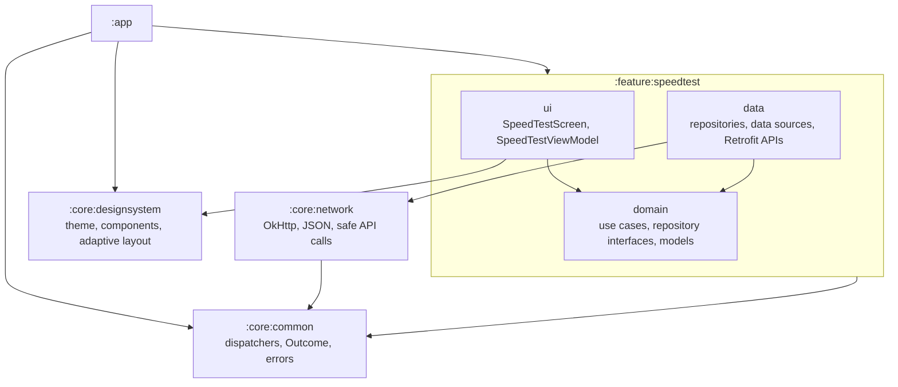
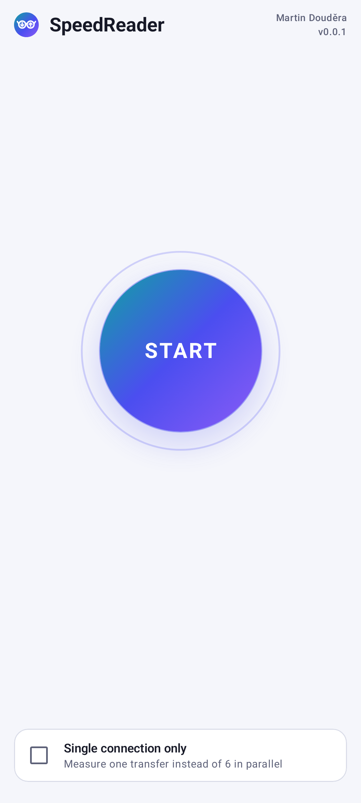
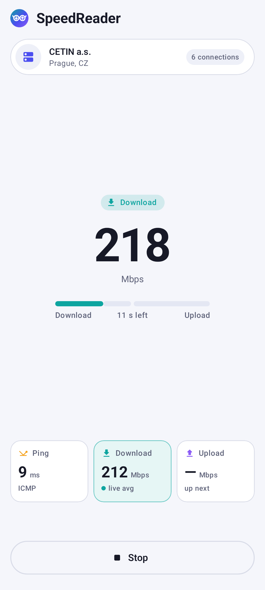
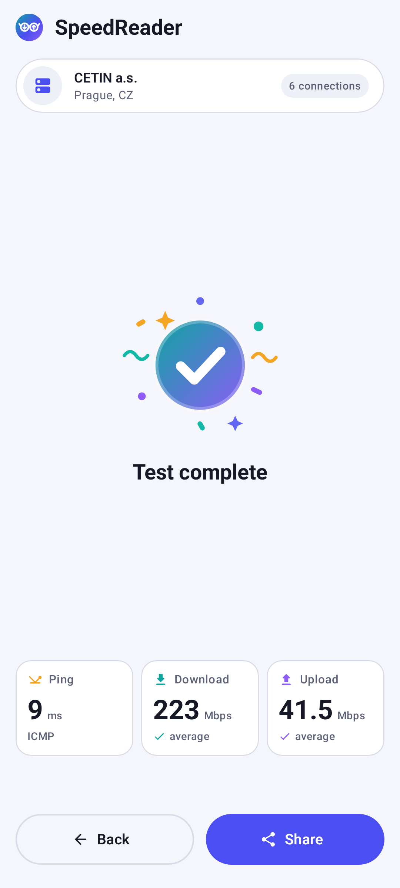
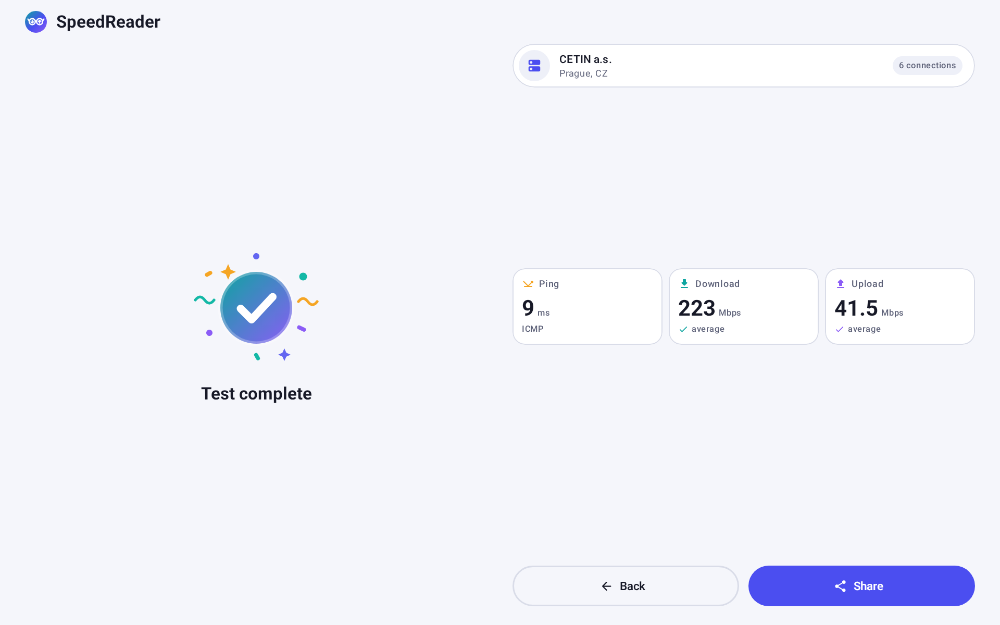

# SpeedReader

A native Android speed test against Ubiquiti's measurement servers. It fetches the server list from
`sp-dir.uwn.com`, picks the five closest servers, pings them with real ICMP, and measures download
and upload against the one with the lowest round-trip time.

*Why the name? It sounds similar to CashReader, the app I currently work on, so I picked it.* 🙂

The project is written as production code, not a prototype:

- **Stack:** Kotlin, Jetpack Compose (Material 3), Coroutines and StateFlow, Hilt, Retrofit +
  kotlinx.serialization, OkHttp, Timber.
- **Architecture:** clean architecture with `data` / `domain` / `ui` layers inside a multi-module
  build (`:app`, `:core:common`, `:core:network`, `:core:designsystem`, `:feature:speedtest`), with
  Gradle convention plugins in `build-logic`. A single screen, so no navigation library. The
  screen is state-hoisted and can become a navigation destination without touching anything below
  it.
- **Architecture tests:** Konsist rules enforce the layering, naming and Compose conventions that
  module boundaries alone cannot express.
- **Tests:** unit tests with fakes (Given-When-Then), MockK where a fake would add nothing, Turbine
  for Flow assertions, MockWebServer for the HTTP layer, screenshot tests of the adaptive layouts
  (phone, landscape, foldable, tablet, dark theme, 2× font), coverage gated at 80 % with Kover.
- **Code quality:** Spotless + ktlint (Android Studio style), all of it run by GitHub Actions on
  every pull request.
- **Release build:** R8 with ProGuard rules shrinks, optimises and obfuscates the code, repackages
  all classes into one package, strips debug logging, and keeps line numbers so crash stack traces
  can be retraced with `mapping.txt`.
- **Adaptive UI** for phones, foldables and tablets via window size classes.

This is the setup I currently use in production apps.

Module and layer dependencies, where an arrow means "depends on". The Gradle module graph guards
the modules, Konsist guards the layers inside the feature.



The current debug build is ready to download and install: [apk/debug.apk](apk/debug.apk). To build
it yourself:

```bash
./gradlew installDebug
```

Minimum SDK is 26, because only from Android 8.0 does `InetAddress.isReachable()` send a real ICMP
echo instead of a TCP connect to port 7 (see 4).

[Pull request #1](https://github.com/doudasek/SpeedReader/pull/1) is a sample that shows the GitHub
Actions checks passing (Spotless, build, unit tests with coverage, screenshot tests). It is only an
example, a real pull request should never be this big. For small pull requests I normally prefer
squash merging, which keeps the history linear with references to JIRA tickets. Here I chose rebase
to keep the individual commits in the history.

## Decisions I had to make myself

The assignment left several things open, and the API is not documented at all. These are the
places where I made a call and would like to know whether it matches the intent.

### 1. The API is reverse-engineered

There is no public documentation for `sp-dir.uwn.com`. Every endpoint, parameter and limit was
derived from the wifiman.com web client and then verified by hand with `curl`, watching how the
servers behave: the 80 s token TTL (checked only when a request starts, not during a stream), the
minimum download size, that servers cut a download off after roughly 30 s and an upload after
about 20 s, that only HTTP/1.1 is served. The client is built to tolerate what I observed (fresh
token per run, one retry on `401`, server entries decoded one by one so a malformed entry does not
drop the whole list), but anything here may be imprecise. With the official API documentation I
would revisit these assumptions first.

Two things in the server list surprised me. It is already filtered by the client's IP on the server
side: a Czech IP gets nine servers from Czechia and Austria, not the whole fleet. And the `city`
labels sometimes contradict the coordinates. An excerpt of the response, trimmed to the relevant
fields:

```json
[
  { "provider": "Lunoxia",             "city": "Berlin", "countryCode": "DE", "latitude": 48.2048, "longitude": 16.3801 },
  { "provider": "schoebel-online.net", "city": null,     "countryCode": "AT", "latitude": 48.2048, "longitude": 16.3801 },
  { "provider": "Indeno GmbH",         "city": "Graz",   "countryCode": "AT", "latitude": 48.2202, "longitude": 16.3529 }
]
```

The server labelled *Berlin, DE* has exactly the same coordinates as an Austrian one, and both are
in Vienna. *Graz* is in Vienna too, about 145 km from Graz. The coordinates look like the real
hosting location and the labels like registration metadata, so distance is computed from the
coordinates only, and the UI leads with the provider name rather than the city.

### 2. Location comes from the IP, not from the phone

The assignment asks for the servers closest to the *current location of the phone*. I read that
as "closest to where the traffic actually leaves", and use the IP geolocation endpoint the
directory already offers (`GET /api/v1/ip`) instead of the device location:

- Asking for a location permission just to run a speed test is hard to justify to a user.
- The measured path starts at the network's gateway, not at the phone. On mobile networks the
  gateway can be hundreds of kilometres away, so a server close to the phone's GPS fix can be
  further away in network terms than one close to the public IP.
- The candidate list is IP-filtered anyway, so ranking it by the same IP is consistent.
- In practice it barely matters: moving the origin by 175 km changed one of the five candidates,
  and it swapped two servers at identical coordinates. The winner is picked by ICMP latency, not
  distance.

If device location was really meant, it is one more `LocationRepository` implementation plus a
runtime location permission, though I would not recommend it for the reasons above.

### 3. One connection or six

The assignment does not say how many connections to measure with, and speed tests differ: some
measure over a single connection, others over several in parallel. The wifiman web client uses six
parallel connections when it measures against a single server, and twelve spread over up to four
servers in its normal run. This app measures one server at a time, so six is the default here, and
a **"Single connection only"** checkbox switches to one. The two answer different questions, what the link can carry versus what one transfer
achieves, so I left the choice to the user rather than hiding it behind one number. Both modes
are the same code path with a different connection count.

### 4. Real ICMP ping, with a fallback

The assignment forbids wifiman's HTTP pseudo-ping. The app uses `InetAddress.isReachable()`, which
on Android 8.0+ sends a real ICMP echo over an unprivileged ping socket and falls back to TCP
port 7 only when ICMP gets no answer. Such slower answers are discarded. Each server gets up to
three 500 ms probes and the minimum RTT wins, since queueing only ever adds delay. Some networks
block ICMP entirely. Instead of failing a test that HTTP could still run, the app then measures
against the closest candidate and shows the ping as "—". Emulator RTTs are
meaningless, so ping must be checked on a real device.

### 5. Test duration

I read the assignment's 15 s as the length of the whole test. The app measures both download
and upload, so I split it in half: 7.5 s download, then 7.5 s upload. TCP slow start at the
beginning of each transfer weighs a bit more in the shorter window. Restoring a full 15 s download
is a one-constant change.

## What is missing or should be improved

- **Accessibility pass.** No TalkBack walk-through yet: live speed and phase changes are not
  announced (`liveRegion`), metric cards are not merged into one focusable unit, the title is not
  marked as a heading.
- **Retries.** Apart from the token refresh, nothing retries and a failed run is restarted with Start.
  Transient directory failures deserve a short, time-boxed backoff. A dropped transfer stream is
  not reopened. The others carry on, and the test fails only when all of them fail.
- **Average speed.** It is plain total bytes over total time, so TCP slow start counts and the result
  reads a few percent lower than wifiman's, which trims the samples. Trimming is worth revisiting
  with more measurements.
- **Metered network warning.** Six streams on fast mobile data can use a few hundred MB per run.
  The app should ask first on a metered network and show how much data a run used.
- **Remote config.** Base URL, test length, connection count and ping parameters are compile-time
  constants. Against an undocumented API that can change at any time, they belong in remote config
  together with a kill switch.
- **Crash reporting and analytics.** Timber logs only in debug builds. Release needs a Timber tree
  forwarding warnings and errors to Crashlytics or Sentry (with the R8 mapping uploaded), and
  failure-rate analytics per error type would catch the API breaking.
- **Release signing and distribution.** There is no signing config and no pipeline to Google Play
  (signed AAB, service account, internal track).
- **Privacy policy and Data safety.** Each run sends the public IP to Ubiquiti, which Play counts
  as data shared with a third party.
- **Richer UI.** A gauge or live throughput graph, details of each candidate server with its RTT,
  jitter, and a history of past runs. Foldable postures (tabletop, book) are handled only through
  the window size, not through `FoldingFeature`.

## Screenshots

Phone: start, measuring, result.

<p>
  
  
  
</p>

Tablet, result:


